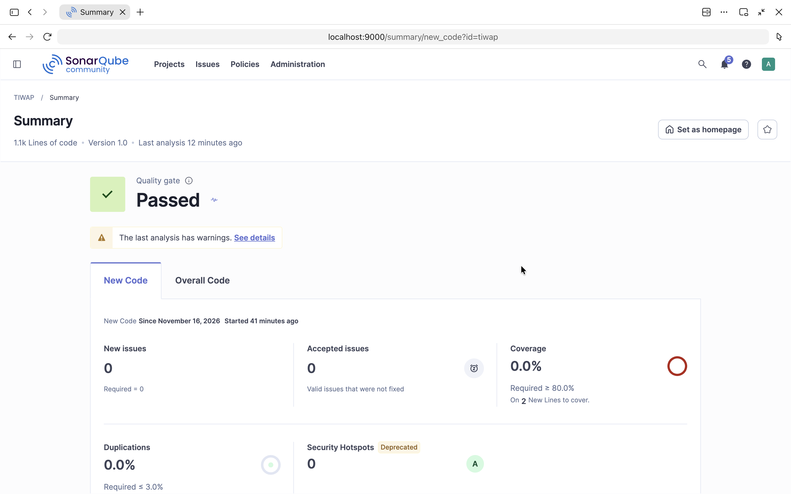

# TP2 : injection SQL dans TIWAP, détection avec SonarQube et correction

Application étudiée : TIWAP (tombstoneghost/TIWAP, commit `1f9d2ac`), copiée dans `TIWAP/`.
Environnement : macOS sur processeur ARM, podman 6.1.4 et podman-compose 1.6.0 à la place de Docker, SonarQube Community Build 26.11.0.134175, SonarScanner CLI 8.4.

## 1. Architecture déployée

Le fichier [`compose.yaml`](../compose.yaml) décrit trois services sur un réseau privé `sonarnet` :

| Service | Image | Rôle |
|---|---|---|
| `db` | `postgres:17-alpine` | Base de SonarQube (projets, analyses, historique, utilisateurs). Healthcheck `pg_isready`. |
| `sonarqube` | `sonarqube:community` | Serveur et interface web, publiés sur `127.0.0.1:9000` uniquement. Démarre quand la base est saine. |
| `scanner` | image construite depuis [`scanner/Dockerfile`](../scanner/Dockerfile) | Analyse `./TIWAP`, monté dans `/usr/src`, et envoie le rapport à `http://sonarqube:9000`. |

Quatre volumes nommés gardent les données de PostgreSQL et de SonarQube entre deux redémarrages. Le mot de passe de la base vient de `.env`, ignoré par git ; `.env.example` sert de modèle. Le jeton du scanner passe par une variable d'environnement et n'est écrit dans aucun fichier versionné.

Le scanner est placé dans un profil `scan` pour que `docker compose up -d` ne le lance pas. Avec podman-compose, `run` n'active pas ce profil tout seul, il faut l'indiquer :

```bash
podman compose up -d
podman compose --profile scan run --rm scanner
```

Deux ajustements ont été nécessaires sur cette machine :

- podman refuse les noms d'images courts sans demande interactive, les images sont donc écrites en entier (`docker.io/library/...`) ;
- l'image officielle `sonarsource/sonar-scanner-cli` n'existe qu'en amd64. Sous émulation, son analyseur JavaScript ne répond plus et fait échouer tout le scan. Les deux premiers scans ont donc été faits en excluant les fichiers JS, HTML et CSS. Le scanner est maintenant construit en arm64 natif : SonarScanner CLI 8.4 (zip générique, sans JRE embarqué) sur `amazoncorretto:21-alpine`, avec Node.js pour l'analyseur JS. SonarQube 26.11 refuse Java 17 (« Java 17 is not supported »), d'où Java 21. Le téléchargement automatique de JRE est désactivé, car le JRE fourni par le serveur est compilé pour glibc et ne tourne pas sur Alpine.

La machine virtuelle podman a 3,9 Go de mémoire. SonarQube a été tué une fois par manque de mémoire (`OOMKilled=true`) quand un scan a démarré pendant que le serveur traitait encore le rapport précédent. Il suffit de laisser le traitement finir entre deux scans, ou de donner plus de mémoire à la VM.

**Question 1.** SonarQube garde dans PostgreSQL tout ce qui doit survivre au conteneur : configuration, projets, historique des analyses, statut des anomalies, comptes et jetons. Le conteneur applicatif peut être supprimé ou mis à jour sans perte. La base embarquée H2 n'est prévue que pour l'évaluation, et une base séparée se sauvegarde et se supervise avec les outils habituels.

**Question 2.** Pour un conteneur, `localhost` désigne le conteneur lui-même. Le scanner joint donc SonarQube par le nom du service, `sonarqube`, que le DNS du réseau `sonarnet` résout. Le navigateur tourne sur l'hôte, où le port 9000 du conteneur est publié sur `127.0.0.1:9000`.

## 2. Analyse initiale

Le scan a réussi (journal : [`preuves/scan-avant.log`](preuves/scan-avant.log)). Il porte sur 1 084 lignes de Python et un Dockerfile, avec le profil par défaut « Sonar way core » (232 règles).

| Mesure | Valeur |
|---|---|
| Problèmes de sécurité | 24 (note E) |
| Problèmes de fiabilité | 8 (note C) |
| Problèmes de maintenabilité | 6 (note A) |
| Répartition | 2 Blocker, 16 High, 12 Medium, 8 Low |
| Security Hotspots | 0 |
| Quality Gate | OK, car une première analyse n'a pas de « nouveau code » |

La liste complète est dans [`preuves/resultats-avant.md`](preuves/resultats-avant.md). Voici les résultats retenus, qualifiés après lecture du code :

| Identifiant | Fichier et ligne | Règle | Type | Impact potentiel | Confiance | Action |
|---|---|---|---|---|---|---|
| 9d8ccf55 | app.py:29 | python:S6779 | Vulnérabilité (Blocker) | Clé secrète Flask en dur : on peut forger des cookies de session | Confirmé | Corriger (variable d'environnement) |
| 292e04cb | helper/auth.py:39 | python:S5659 | Vulnérabilité (High) | JWT décodé sans vérifier la signature : usurpation d'identité | Confirmé | Corriger |
| cdec085d, edab0950, ebc9f233 | app.py:723, 728, 731 | python:S4830 | Vulnérabilité (High) | Requêtes HTTPS sans vérification du certificat : interception possible | Confirmé | Corriger |
| 77e49768, 34723869 | helper/db_manager.py:47, 55 | python:S4790 | Vulnérabilité (High) | Mots de passe hachés en MD5 sans sel : cassables rapidement | Confirmé | Corriger (bcrypt ou argon2) |
| 69a740b0 | app.py:28 | python:S4502 | Vulnérabilité (High) | Aucune protection CSRF sur les formulaires Flask | Confirmé | Corriger |
| 87c393f1, ff2da581 | app.py:913 | python:S8392, S4507 | Vulnérabilité (Blocker, Low) | Écoute sur toutes les interfaces avec le mode debug actif | Confirmé | Corriger avant tout déploiement |
| aucun | vulnerabilities/SQLi.py:22 | aucune | Non détecté | Injection SQL : lecture de toute la table `users` | Confirmé à la main et par un test | Corriger (objet de ce TP) |

### L'injection SQL n'est pas signalée

SonarQube ne signale aucune injection SQL dans `vulnerabilities/SQLi.py`. Le seul problème relevé dans ce fichier est le MD5 de la ligne 151. Deux raisons :

- la règle `python:S2077` (« SQL queries should not be dynamically formatted ») est active dans le profil par défaut, mais elle ne s'est pas déclenchée sur `stmt = "..." % (...)` suivi de `cur.execute(stmt)` ;
- la règle `python:S3649`, qui suit une entrée HTTP jusqu'à la requête (taint analysis), n'existe pas dans l'édition Community : l'API répond `Rule not found`. Cette analyse est réservée aux éditions payantes.

L'injection a donc été identifiée par revue manuelle, comme le demande le TP dans ce cas.

### Analyse complète avec le scanner arm64

Avec le scanner natif, l'analyse couvre aussi les 34 fichiers JS et CSS et les templates HTML : 2 367 lignes au lieu de 1 084 (journal : [`preuves/scan-complet-avant.log`](preuves/scan-complet-avant.log), sur la version vulnérable de `SQLi.py`).

| Mesure | Python seul | Analyse complète |
|---|---|---|
| Problèmes au total | 32 | 51 |
| Sécurité | 24 (note E) | 30 (note E) |
| Fiabilité | 8 (note C) | 21 (note C) |
| Maintenabilité | 6 (note A) | 7 |
| Quality Gate | OK | En échec |

Les six nouveaux problèmes de sécurité :

| Identifiant | Fichier et ligne | Règle | Sévérité | Constat | Confiance | Action |
|---|---|---|---|---|---|---|
| 153d5ddb, 4663c5d6 | init-db.js:8, 12 | javascript:S2068 | Medium | Mots de passe des comptes MongoDB de démonstration en dur, hachés en MD5 sans sel (`21232f29…` est le MD5 de « admin ») | Confirmé | Corriger (données d'initialisation hors du dépôt, hachage robuste) |
| 6338dacb, 51029145, 44bce632, b8712e50 | templates/dashboard_layout.html:19-21, templates/vulnerabilities/xml-external-entities.html:24 | Web:S5725 | Low | Bootstrap et jQuery chargés depuis un CDN sans attribut `integrity` : un CDN compromis pourrait servir un script modifié | Confirmé | Ajouter SRI ou héberger les fichiers |

Les autres nouveaux problèmes concernent la fiabilité des templates, surtout l'accessibilité (champs de formulaire sans `<label>`, tableau sans en-têtes).

L'analyse des templates ne signale pas les XSS du laboratoire. Huit templates affichent une donnée avec le filtre Jinja `| safe`, qui désactive l'échappement (par exemple `templates/vulnerabilities/reflected-xss.html:19`). SonarQube n'en relève aucun.

Le Quality Gate passe en échec parce que la période « nouveau code » démarre à la première analyse (mode « version précédente »). Tous les fichiers web, analysés pour la première fois, comptent donc comme du nouveau code : 19 nouveaux problèmes et 13,5 % de lignes dupliquées, au-delà des seuils de 0 et 3 %. L'échec vient de l'élargissement du périmètre, pas de la correction.

## 3. Examen du code

Recherche des pistes :

```bash
grep -RInE "execute\(|SELECT|request\.args|request\.form" TIWAP --include="*.py"
```

`helper/db_manager.py` utilise partout des paramètres `?` et n'est pas vulnérable. En revanche, toutes les fonctions de `vulnerabilities/SQLi.py` construisent la requête par formatage de chaîne. J'ai retenu `sqli_low`, le niveau « facile » du module.

Chemin de la donnée :

1. `app.py:145-146` : la route `/sql-injection` lit `username` et `password` dans `request.form`, sans contrôle ;
2. `app.py:147` : ces deux valeurs sont passées telles quelles à `SQLi.sqli_low` ;
3. `SQLi.py:18` : si l'utilisateur existe, la fonction s'arrête sur « User Exists » ; sinon elle continue ;
4. `SQLi.py:22-25` : les deux valeurs sont insérées dans le texte SQL par `%s`, puis la chaîne est exécutée.

```python
stmt = "SELECT userid, username FROM users WHERE username='%s' AND password='%s'" \
       % (str(username), str(password))

result = cur.execute(stmt)
```

Avec `username = x' OR '1'='1' --`, la requête devient :

```sql
SELECT userid, username FROM users WHERE username='x' OR '1'='1' --' AND password='...'
```

L'apostrophe ferme la chaîne, `OR '1'='1'` rend la condition toujours vraie et `--` met en commentaire le contrôle du mot de passe. La fonction renvoie alors les cinq comptes de la base. Le test l'a vérifié avant correction ([`preuves/tests-avant-correction.txt`](preuves/tests-avant-correction.txt)). Une simple apostrophe dans le mot de passe fait aussi planter la requête, et le message d'erreur SQLite est renvoyé à l'utilisateur, ce qui l'aide à ajuster son attaque.

## 4. Correction

La correction a été faite sur la branche `fix/sql-injection-lab`, puis fusionnée dans `main`. Seule `sqli_low` change :

```diff
-        stmt = "SELECT userid, username FROM users WHERE username='%s' AND password='%s'" \
-               % (str(username), str(password))
+        # requête paramétrée : sqlite3 transmet les valeurs à part, jamais dans le texte SQL
+        stmt = "SELECT userid, username FROM users WHERE username = ? AND password = ?"

-        result = cur.execute(stmt)
+        result = cur.execute(stmt, (str(username), str(password)))
```

Le texte de la requête est désormais fixe. Le module `sqlite3` compile la requête avec ses marqueurs `?` et lie les valeurs ensuite : une apostrophe dans `username` reste un caractère du nom cherché et ne peut plus fermer la chaîne. `?` est le marqueur de `sqlite3` (paramstyle `qmark`) ; psycopg utiliserait `%s`, avec la même séparation.

Le comportement visible ne change pas : un utilisateur existant donne toujours « User Exists », un utilisateur inconnu donne une liste vide.

## 5. Tests de non-régression

TIWAP n'avait aucun test. J'ai ajouté [`TIWAP/tests/test_sqli_low.py`](../TIWAP/tests/test_sqli_low.py), qui travaille sur une copie temporaire de `TIWAP.db` :

| Test | Vérifie |
|---|---|
| `test_payload_classique_ne_renvoie_aucun_utilisateur` | `x' OR '1'='1' --` renvoie une liste vide |
| `test_quote_dans_le_mot_de_passe_ne_casse_pas_la_requete` | une apostrophe ne provoque plus d'erreur SQL |
| `test_utilisateur_inconnu` | cas normal, liste vide |
| `test_utilisateur_existant_inchange` | « User Exists » est toujours renvoyé |

```bash
cd TIWAP && python3 -m unittest discover -s tests -v
```

Avant correction, deux tests sur quatre échouent : le payload renvoie les cinq comptes et l'apostrophe déclenche `OperationalError`. Après correction, les quatre passent ([`preuves/tests-apres-correction.txt`](preuves/tests-apres-correction.txt)). Le test a été commité avant le correctif, l'historique git montre donc l'échec puis la réussite.

## 6. Comparaison avant et après

Scans après correction : [`preuves/scan-apres.log`](preuves/scan-apres.log) (Python seul) et [`preuves/scan-complet-apres.log`](preuves/scan-complet-apres.log) (analyse complète).

| Critère | Avant correction | Après correction |
|---|---|---|
| Anomalie étudiée | Injection SQL dans `sqli_low`, non signalée par SonarQube | Corrigée |
| Règle concernée | `python:S2077` active mais muette ; `python:S3649` absente de l'édition Community | Inchangé |
| Emplacement | `vulnerabilities/SQLi.py:22-25` | Même endroit, requête paramétrée |
| Code vulnérable présent ? | Oui (formatage `%s`) | Non dans `sqli_low` ; oui dans les autres fonctions de `SQLi.py` |
| Tests de régression | 2 échecs sur 4 | 4 réussites sur 4 |
| Mesures SonarQube (Python seul) | 24 problèmes de sécurité, note E | 24 problèmes de sécurité, note E |
| Mesures SonarQube (analyse complète) | 30 problèmes de sécurité, 5 bugs, 16 code smells | Identiques |
| Risque résiduel | Élevé | Faible pour `sqli_low`, élevé pour le reste du module |

Le tableau de bord ne bouge pas, ce qui est cohérent : l'outil ne voyait pas l'injection, il ne peut pas voir sa disparition. La preuve de la correction vient du diff et des tests.



La capture date du scan Python seul. La vue « New Code » après correction y affiche un Quality Gate validé et aucun nouveau problème. La couverture est de 0 % sur les 2 lignes modifiées : les tests tournent avec `unittest`, sans rapport de couverture envoyé à SonarQube. Le Quality Gate passe malgré le seuil de 80 %, parce que SonarQube ignore les conditions de couverture quand le nouveau code est très court. La carte « Security Hotspots » est marquée « Deprecated » dans cette version, ce qui explique les 0 hotspots : les résultats de ce type apparaissent directement parmi les problèmes de sécurité.

Restent vulnérables dans `SQLi.py` : `sqli_medium`, `sqli_hard`, les trois `blind_sqli_*` et `secure_login` (ligne 145). Cette dernière est intéressante : elle retire les apostrophes et les guillemets avant d'insérer le nom dans une f-string. C'est un filtrage par liste noire, pas une requête paramétrée, et l'injection reste possible selon le contexte. Ces fonctions sont gardées telles quelles parce que TIWAP sert à s'entraîner sur ces failles.

## 7. Fiche de traitement (contexte NOVA SERVICES)

Si ce code tournait dans une application de NOVA SERVICES, l'anomalie serait suivie ainsi :

| Champ | Valeur |
|---|---|
| Actif | Application web avec authentification et table des comptes clients |
| Anomalie | Injection SQL dans la recherche d'utilisateur (`SQLi.py:22`), CWE-89 |
| Source de détection | Revue manuelle ; non détectée par SonarQube Community |
| Exploitabilité | Triviale, sans authentification préalable sur cette fonction, payload public |
| Impact | Confidentialité forte (lecture de tous les comptes), intégrité possible selon les droits de la base |
| Priorité | P1 (critique) pour une application exposée à Internet ; P3 pour un outil de test isolé comme TIWAP |
| Responsable | Développeur référent de l'application ; validation par l'équipe sécurité |
| Échéance | 7 jours pour une P1 exposée ; correctif d'urgence ou désactivation de la fonction sous 24 h si une exploitation est observée |
| Statut | Corrigé et vérifié pour `sqli_low` ; ouvert pour les autres fonctions du module |
| Preuve de correction | Commit du correctif, test de non-régression rouge puis vert, revue du diff, test exécuté en CI à chaque push |
| Risque résiduel | Les autres requêtes formatées du module ; à suivre jusqu'à leur correction |

La priorité vient de l'exposition et des données touchées. La sévérité affichée par l'outil n'entre pas en compte ici, puisque l'outil n'a rien affiché.

## 8. Indicateurs de pilotage

| Indicateur | Définition | Source | Fréquence | Responsable | Décision permise |
|---|---|---|---|---|---|
| Vulnérabilités ouvertes par priorité | Nombre d'anomalies qualifiées P1 à P4 non fermées, par application | SonarQube et outil de tickets | Hebdomadaire | RSSI | Réaffecter des développeurs vers les applications qui accumulent des P1 et P2 |
| Vulnérabilités P1/P2 hors délai | Anomalies P1 et P2 dont l'échéance est dépassée | Outil de tickets | Hebdomadaire | Responsable sécurité applicative | Escalader au comité de direction, accepter formellement le risque ou bloquer une mise en production |
| Délai médian de correction | Médiane du temps entre la qualification et la fermeture vérifiée, par priorité | Outil de tickets | Mensuelle | Responsable sécurité applicative | Vérifier que les délais de la politique sont tenables et les revoir si besoin |
| Corrections vérifiées | Part des anomalies fermées avec une preuve : nouveau scan, test de non-régression ou retest manuel | Outil de tickets et CI | Mensuelle | Lead technique de chaque équipe | Refuser la fermeture des tickets sans preuve |
| Taux de réouverture | Part des anomalies corrigées qui réapparaissent dans les 90 jours | SonarQube (historique) et tickets | Trimestrielle | Responsable sécurité applicative | Cibler la formation ou les tests sur les équipes concernées |
| Couverture de l'analyse | Part des dépôts applicatifs du périmètre avec un scan en CI au cours des 30 derniers jours | Inventaire applicatif et API SonarQube | Mensuelle | Équipe DevSecOps | Prioriser l'intégration des projets non couverts |

Le nombre brut d'anomalies ne figure pas dans ce tableau. Il dépend des règles actives et de la taille du code, et ce TP montre qu'il peut rester identique alors que le risque a baissé.

## 9. Automatisation en CI

Le workflow [`.github/workflows/sonarqube.yml`](../.github/workflows/sonarqube.yml) lance les tests de non-régression, puis l'analyse SonarQube, puis la vérification du Quality Gate, qui fait échouer le job s'il est rouge. `SONAR_TOKEN` et `SONAR_HOST_URL` sont des secrets du dépôt. L'analyse ne tourne pas sur les pull requests venant d'un fork, qui n'ont pas accès aux secrets. Le workflow n'a pas encore été exécuté : il faut un dépôt GitHub et un serveur SonarQube joignable depuis Internet, ce qui n'est pas le cas du serveur de ce TP, limité à `127.0.0.1`.

## 10. Réponses aux questions

1. PostgreSQL stocke l'état persistant de SonarQube : configuration, projets, historique des analyses, statut des anomalies, utilisateurs et jetons. Le conteneur SonarQube peut ainsi être recréé sans perte.
2. Dans un conteneur, `localhost` désigne le conteneur lui-même. Le scanner doit utiliser le nom du service (`sonarqube`), que le DNS du réseau Docker résout. Le navigateur, lui, est sur l'hôte, où le port est publié sur `127.0.0.1:9000`.
3. L'analyse statique lit le code sans l'exécuter. Elle couvre tout le code, y compris les chemins rarement utilisés, tôt dans le cycle, mais produit des faux positifs et rate ce qui dépend de l'exécution (configuration, flux entre composants). Un test d'intrusion dynamique attaque l'application qui tourne : il prouve qu'une faille est exploitable, mais ne voit que les chemins qu'il atteint et arrive plus tard.
4. Si l'entrée est collée dans le texte SQL, la base ne peut plus distinguer le code de la donnée. Une apostrophe ferme la chaîne et la suite de l'entrée est exécutée comme du SQL.
5. Avec une requête paramétrée, le texte SQL est fixé avant que les valeurs arrivent. Le pilote transmet les valeurs à part, et la base les traite toujours comme des valeurs, quel que soit leur contenu.
6. Une validation par liste noire oublie toujours un cas : encodage, autre caractère de fin de chaîne, champ numérique sans apostrophe. `secure_login` dans TIWAP en est l'exemple. La validation reste utile pour les règles métier (format, longueur), mais seule la paramétrisation sépare structurellement le code des données.
7. Un résultat peut être un faux positif, et sa sévérité ne dit rien de l'exposition réelle ni des données touchées. Il faut lire le code pour confirmer le résultat et évaluer le risque dans son contexte avant de mobiliser une équipe.
8. Il ne faut pas conclure qu'il n'y en a pas. On vérifie les règles actives et l'édition (ici, la taint analysis est absente de la Community), on fait une revue manuelle des requêtes et des entrées, on complète avec un test dynamique (sqlmap, DAST), et on documente la limite dans le rapport. C'est ce qui a été fait ici.
9. On croise la criticité de l'application et des données, l'exposition (Internet ou réseau interne), la facilité d'exploitation, l'impact sur la confidentialité, l'intégrité et la disponibilité, et les mesures compensatoires (WAF, droits réduits sur la base). Une injection SQL sur une application métier critique exposée est une P1 : correctif sous quelques jours, mesure de contournement immédiate si besoin.
10. Le total dépend du nombre de règles et de la taille du code. Il mélange des défauts mineurs et des failles critiques, et il ne compte que ce que l'outil sait détecter. Dans ce TP, il reste à 24 avant et après une correction réelle.
11. Le jeton doit être un secret du CI, jamais écrit dans le dépôt ni affiché dans les journaux. Il doit être limité à l'analyse d'un seul projet, et renouvelé ou révoqué régulièrement. Il ne doit pas être exposé aux pull requests venant de forks. Le serveur SonarQube doit être joignable en HTTPS, et les images et actions du pipeline épinglées à une version.
12. Il faut un test de non-régression qui échoue avant le correctif et passe après, exécuté en CI à chaque modification pour que la correction ne puisse pas disparaître sans bruit. On y ajoute la revue du diff, un nouveau scan, et si possible un retest dynamique. Le ticket ne se ferme qu'avec ces preuves.

## 11. Limites de l'analyse statique

Sur TIWAP, l'outil a trouvé 30 vraies faiblesses en quelques minutes : clé secrète en dur, JWT non vérifié, TLS désactivé, MD5, scripts tiers sans contrôle d'intégrité. Il est passé à côté de la faille principale du module étudié. L'édition Community n'a pas la taint analysis, et la règle de formatage SQL, pourtant active, n'a pas reconnu une construction aussi courante que `"..." % (...)` suivie de `execute`. Les huit `| safe` des templates, qui sont les XSS du laboratoire, passent aussi inaperçus.

L'environnement compte autant que les règles : avec l'image officielle sous émulation, la moitié du code (templates, JS, CSS) sortait du périmètre sans que le tableau de bord le montre. Le Quality Gate, lui, a changé de couleur quand le périmètre s'est élargi, sans qu'aucune ligne de code ne change.

Un tableau de bord SonarQube sans alerte SQL ne prouve donc pas l'absence d'injection. L'outil sert à trouver vite les défauts connus. La revue de code, les tests de non-régression et les tests dynamiques restent nécessaires pour le reste, et pour prouver qu'une correction tient.

## 12. Nettoyage

```bash
podman compose down
```

`podman compose down -v` supprime aussi les volumes, donc l'historique des analyses. Le jeton d'analyse est à révoquer dans SonarQube (My Account, Security) à la fin du TP.
